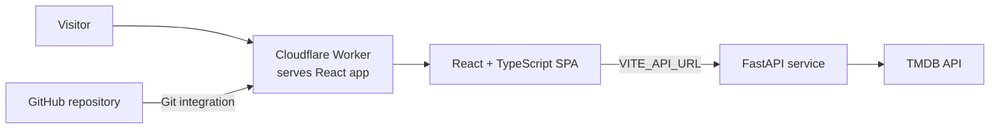

# FlickPick

[](https://github.com/ayomel/flickpicks/actions/workflows/ci.yml)

FlickPick helps you discover movies and TV shows. Browse trending titles, search both, view details and trailers, and save titles to an anonymous watchlist for this browser.

**Try it:** [Live app](https://flickpick.mel-2cb.workers.dev/) · [Frontend repository](https://github.com/ayomel/flickpicks) · [API repository](https://github.com/ayomel/flickpicks-api) · [API docs](https://flickpicks.fastapicloud.dev/docs)

## Product tour

Search shows movies and TV together. Each result is labeled by type and opens its matching detail page, with title information, trailers, and watch options where available. Save movies and shows to this browser's watchlist and return to them from the home page.

### Browse and search


### Title details


### Mixed movie and TV watchlist


## Architecture

The React single-page app runs in the browser and is served by a Cloudflare Worker. It calls the FastAPI service using `VITE_API_URL`, and that service gets catalog data from TMDB. For watchlist requests, the browser stores an anonymous UUID in local storage and sends it as `X-Visitor-ID`; the API scopes reads and writes to that ID. There are no accounts or authentication, and clearing browser data loses access to that browser's list. Cloudflare's dashboard Git integration deploys the frontend Worker from this repository.



Movie and TV detail pages support direct links. For those routes, the Worker serves the app shell and the client router loads the matching page. Unknown routes return an HTTP 404 with the app shell.

## Run locally

Requirements: Node.js and pnpm.

```bash
pnpm install
pnpm dev
```

The `.env.example` file uses a local API at `http://localhost:8000/`. For a production build, set `VITE_API_URL` to `https://flickpicks.fastapicloud.dev/`. Set `VITE_WATCH_BASE_URL` to the HTTPS base URL for movie and TV watch pages, such as `https://7movies.ac`. Vite reads these values at build time. Run the checks and build commands with:

```bash
pnpm lint
pnpm typecheck
pnpm test
pnpm build
pnpm preview
```

## Deployment and routing

The `flickpick` Worker deploys through Cloudflare's dashboard Git integration. `wrangler.jsonc` sets the Worker name, the `./dist` build output, and single-page-app asset handling. GitHub Actions runs lint, typecheck, tests, and build on pushes and pull requests targeting `main`; it does not deploy the application.

| Path | HTTP status | Response |
| --- | --- | --- |
| `/` | 200 | `index.html` |
| `/movies/:digits` | 200 | `index.html` |
| `/tv/:digits` | 200 | `index.html` |
| Unknown paths | 404 | App shell, then the client `NotFound` page |
| `/assets/*` | 200 | Hashed static assets |

Optional local packaging check (does not publish):

```bash
pnpm deploy:dry
```

## Case study

Read the [published case study on melverton.com](https://melverton.com/projects/flickpick) or the [source Markdown](docs/portfolio-case-study.md). It covers the product and engineering work, with links to the [live app](https://flickpick.mel-2cb.workers.dev/), [frontend repository](https://github.com/ayomel/flickpicks), and [API repository](https://github.com/ayomel/flickpicks-api).

## Attribution

This product uses the TMDB API but is not endorsed or certified by TMDB.
