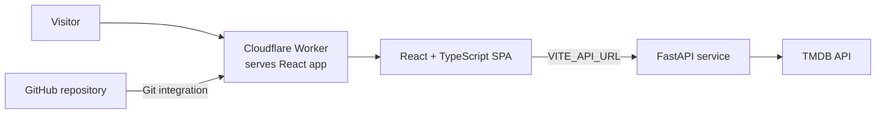

# FlickPick

FlickPick is a movie and TV discovery app. Browse trending titles, search both media types, open detail pages, watch trailers, and keep a mixed watchlist.

**Try it:** [Live app](https://flickpick.mel-2cb.workers.dev/) · [API docs](https://flickpicks.fastapicloud.dev/docs)

## Product tour

Search returns movies and TV shows together, with each result labeled by type and routed to the matching detail page. Detail pages bring together title information, trailers, and watch options where available. Add either movies or shows to the shared watchlist and return to them from the home page.

### Browse and search


### Title details


### Mixed movie and TV watchlist


## Architecture

The browser runs the React single-page app served from Cloudflare Workers. It calls the FastAPI service using `VITE_API_URL`; the service integrates with TMDB for catalog data. Cloudflare's dashboard Git integration deploys the frontend Worker from this repository.



The frontend supports direct links to movie and TV detail pages. The Worker serves the app shell for those routes so the client router can load the matching page; unknown routes return an HTTP 404 with the app shell.

## Run locally

Requirements: Node.js and pnpm.

```bash
pnpm install
pnpm dev
```

Set `VITE_API_URL` to `https://flickpicks.fastapicloud.dev/` and `VITE_WATCH_BASE_URL` to the HTTPS
base URL for movie and TV watch pages (for example, `https://7movies.ac`). These values are read at build time. Available
checks and build commands:

```bash
pnpm lint
pnpm typecheck
pnpm test
pnpm build
pnpm preview
```

## Deployment and routing

Production deploys through the Cloudflare dashboard Git integration for the `flickpick` Worker. `wrangler.jsonc` configures the Worker name, the `./dist` build output, and single-page-app asset handling. CI is planned separately and does not deploy the application.

| Path | HTTP status | Response |
| --- | --- | --- |
| `/` | 200 | `index.html` |
| `/movies/:digits` | 200 | `index.html` |
| `/tv/:digits` | 200 | `index.html` |
| Unknown paths | 404 | App shell, then the client `NotFound` page |
| `/assets/*` | 200 | Hashed static assets |

Optional local packaging check (does not publish):

```bash
pnpm deploy:dry
```

## Case study

See [docs/portfolio-case-study.md](docs/portfolio-case-study.md) for a hiring-manager-oriented overview of the product and engineering work.

## Attribution

This product uses the TMDB API but is not endorsed or certified by TMDB.
