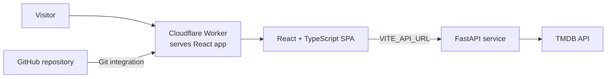

# FlickPick: full-stack case study

> Draft for a full-stack hiring audience. Technical details are based on the current repository and live application; no usage or business metrics are available.

## The product

FlickPick is a deployed movie and TV discovery app. A visitor can browse curated catalog rows, search films and series together, open a detail page, watch an available trailer, and save either type of title to an anonymous watchlist scoped to that browser.

**Links:** [Live product](https://flickpick.mel-2cb.workers.dev/) · [API docs](https://flickpicks.fastapicloud.dev/docs)

## What I built

The React and TypeScript frontend organizes the experience around a browsable home page and media-specific detail routes. Search results preserve their media type, so selecting a show opens its TV page and selecting a film opens its movie page. The watchlist likewise keeps movie and TV entries distinct, including when two records share the same catalog ID.

Movie and TV detail views show type-appropriate metadata and available videos. TV trailer playback was added in [PR #25](https://github.com/ayomel/flickpicks/pull/25), which has merged to the repository's main branch.

## Architecture

The frontend reads its API base URL from `VITE_API_URL` and calls a separate FastAPI service. That service integrates with TMDB. The frontend is built as static assets and served by a Cloudflare Worker configured in `wrangler.jsonc`; the production Worker is connected to the repository through Cloudflare's Git integration.

The browser stores a UUID v4 in local storage and sends it with watchlist requests. The API uses that value to scope entries by visitor. This is anonymous browser-level separation, not account authentication; clearing browser data loses access to the list.

## Engineering highlights

- **One discovery surface for two media types.** Combined search keeps type information through result rendering and navigation, while movie and TV detail screens use the appropriate metadata.
- **Watchlist identity includes media type.** The client distinguishes an entry by both its TMDB ID and whether it is a movie or TV show, which avoids collisions for same-ID records and routes watchlist cards to the right detail page.
- **Watchlists are scoped to an anonymous browser ID.** The client persists a UUID v4 in local storage and sends it with watchlist requests; the API only returns or mutates entries with that owner ID. Existing shared rows are retained under a reserved demo owner and hidden from visitor IDs.
- **Direct detail links work at the edge.** The Cloudflare Worker serves the SPA shell for valid movie and TV routes, allowing the client router to render after a direct load. Unknown paths retain an HTTP 404 response.
- **Trailer playback is user initiated.** Available videos are presented on detail pages, and the trailer player opens only after the user selects playback.

## Outcome

The result is a live, end-to-end product that connects a typed React interface to a FastAPI-backed catalog, handles both films and series across discovery and saved-title flows, and serves shareable detail routes through Cloudflare. This case study makes no quantitative impact claim because product usage metrics are not available.

## Stack

- React, TypeScript, Vite
- FastAPI
- TMDB API
- Cloudflare Workers and repository Git integration
- pnpm

## Screenshots

The current UI examples are embedded in the [project README](../README.md#product-tour).
